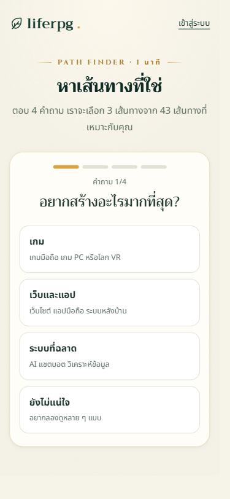
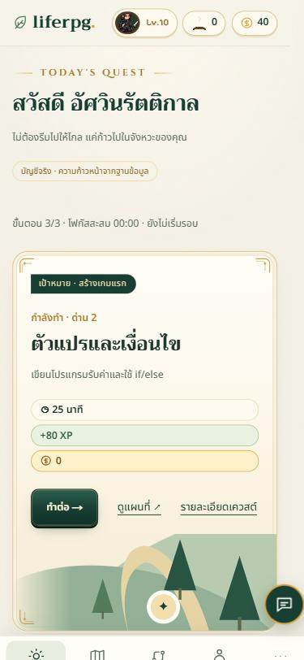
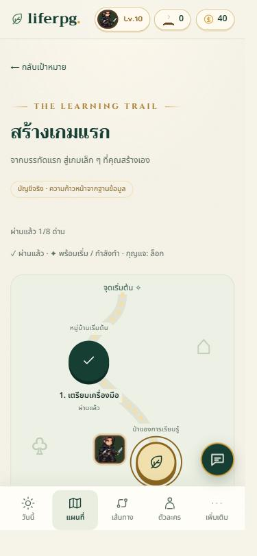
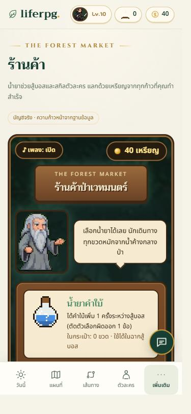
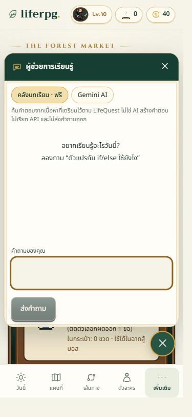
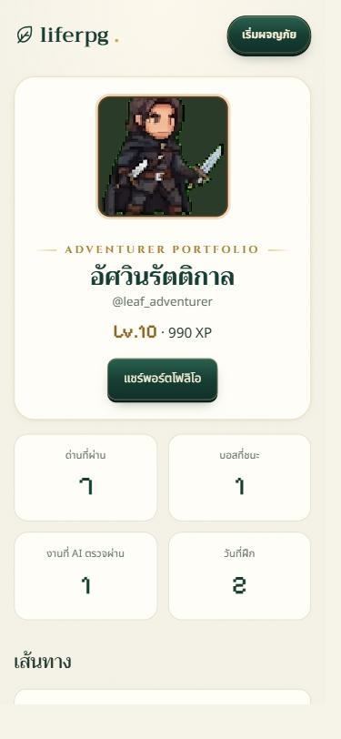

# liferpg — เรียนสายเทคแบบเล่นเกม RPG

แอปมือถือสำหรับฝึกทักษะสายเทคโนโลยี (AI, การพัฒนาซอฟต์แวร์ และการพัฒนาเกม) ในรูปแบบเกม RPG ผู้เล่นเลือกเส้นทาง เดินแผนที่ทีละด่าน ลงมือทำงานจริง ส่งงานให้อาจารย์ AI ตรวจ แล้วสู้บอสด้วยการตอบคำถาม เพื่อรับ XP เหรียญ และเลเวลอัป

| | |
|---|---|
| **เว็บแอป (PWA)** | https://liferpg-five-zeta.vercel.app — เปิดบนมือถือแล้วกด "เพิ่มลงหน้าจอหลัก" เพื่อติดตั้ง |
| **แอป Android (APK)** | `mobile/liferpg.apk` — ติดตั้งบน Android 5.1 ขึ้นไป (ดู [การติดตั้ง APK](#แอป-android-apk)) |
| **สคริปต์สาธิต** | [docs/demo-script.md](docs/demo-script.md) |

| หาเส้นทาง | วันนี้ | แผนที่ | ร้านค้า | ผู้ช่วย AI | พอร์ตโฟลิโอ |
|---|---|---|---|---|---|
|  |  |  |  |  |  |

## ปัญหาที่แอปแก้

คนที่อยากเริ่มเรียนสายเทคมักเจอปัญหาเดิม ๆ: ไม่รู้จะเริ่มสายไหน เนื้อหามีเยอะจนไม่รู้ลำดับ เรียนแล้วไม่ได้ลงมือทำ และเลิกกลางทางเพราะไม่มีแรงจูงใจ liferpg แก้ด้วย

1. **แบบทดสอบหาเส้นทาง** 4 คำถาม เลือก 3 เส้นทางจาก 43 เส้นทางที่เหมาะกับผู้เรียน
2. **แผนที่ 8 ด่านต่อเส้นทาง** เรียงจากง่ายไปยาก แต่ละด่านมีขั้นตอนย่อย ตัวจับเวลาโฟกัส และเงื่อนไขสำเร็จที่ชัดเจน
3. **อาจารย์ AI ตรวจงานจริง** ต้องส่งโค้ด ข้อความ หรือรูปผลงานให้ผ่านก่อน จึงไม่ใช่แค่กดผ่าน
4. **กลไกเกม** บอส 8 ตัว ร้านค้า สกิน 24 แบบ กองไฟ streak เลเวลอัป และกิลด์แข่งกับเพื่อน
5. **พอร์ตโฟลิโอสาธารณะ** รวมด่านที่ผ่านและงานที่ AI ตรวจแล้ว แชร์เป็นลิงก์ได้

## ฟีเจอร์หลัก

| หมวด | รายละเอียด | หน้า |
|---|---|---|
| เริ่มต้น | หน้าแนะนำแอป, แบบทดสอบหาเส้นทาง, โหมด demo ไม่ต้องสมัคร | `/`, `/start` |
| บัญชี | สมัคร/เข้าสู่ระบบด้วยอีเมลหรือ Google, ลืมรหัสผ่าน, ตั้งชื่อตัวละคร | `/login`, `/profile` |
| การเรียน | 43 เส้นทาง × 8 ด่าน, คลังความรู้และแบบทดสอบ, ตัวจับเวลาโฟกัส, ฝึกประจำวัน | `/goals`, `/learn`, `/quests/…` |
| AI | อาจารย์ AI ตรวจงาน, ผู้ช่วยตอบคำถามแบบลอยทุกหน้า, ที่ปรึกษากิลด์ตอบบันทึก (Gemini) | ทุกหน้า |
| เกม | สู้บอสแบบ turn-based พร้อมเพลง, ร้านค้าไอเทมและสกิน, เลเวล, เหรียญรางวัล | `/shop`, `/character` |
| วางแผน | ตารางแผนรายเดือน, บันทึกการเดินทาง, รายงานรายสัปดาห์, สถิติ | `/plan`, `/journal`, `/progress` |
| สังคม | พอร์ตโฟลิโอสาธารณะพร้อมการ์ดแชร์, กิลด์และอันดับ XP รายสัปดาห์ | `/u/[ชื่อ]`, `/guild` |
| มือถือ | ออกแบบ mobile-first, เมนูแถบล่าง, ติดตั้งเป็น PWA ได้, แอป Android (Capacitor) | — |

## เทคโนโลยี

| ส่วน | เทคโนโลยี |
|---|---|
| Frontend | Next.js 16 (App Router), React 19, TypeScript, Tailwind CSS 4 |
| Backend | Next.js Route Handlers และ Server Actions |
| ฐานข้อมูล / Auth | Supabase (PostgreSQL + Row Level Security, Supabase Auth) |
| AI | Google Gemini API (เรียกจากฝั่งเซิร์ฟเวอร์เท่านั้น มีโควตาต่อผู้ใช้) |
| แอปมือถือ | PWA (Web App Manifest) และ Capacitor 6 สำหรับ Android |
| Deploy | Vercel |
| ทดสอบ | Node test runner + PGlite (PostgreSQL จริงในหน่วยความจำ) |

## สถาปัตยกรรม

```
มือถือ / เบราว์เซอร์ (PWA หรือแอป Android)
        │  HTTPS
        ▼
Next.js บน Vercel ── Server Components, Route Handlers (/api/*), Server Actions
        │                         │
        │ Supabase client         │ Gemini API (คีย์อยู่ฝั่งเซิร์ฟเวอร์เท่านั้น)
        ▼                         ▼
Supabase PostgreSQL          Google Gemini
  • RLS เปิดทุกตาราง (29 ตาราง)
  • คำสั่งเกมผ่านฟังก์ชัน liferpg_command (security definer)
  • XP/เหรียญคำนวณจาก reward ledger เท่านั้น
```

**การออกแบบด้านความปลอดภัย**

- เบราว์เซอร์ไม่เคยส่ง XP เหรียญ เวลา หรือ user ID ให้เซิร์ฟเวอร์เชื่อ ทุกการให้รางวัลคำนวณในฐานข้อมูลจากนิยามเควสต์
- เฉลยคำถามบอสเก็บใน schema `private` ผู้เล่นอ่านไม่ได้ เซิร์ฟเวอร์ตรวจคำตอบเอง
- ผลตรวจงานจาก AI บันทึกได้เฉพาะเซิร์ฟเวอร์ (service role) ผู้เล่นปลอมผลไม่ได้
- คำขอที่เปลี่ยนข้อมูลต้องมาจาก origin เดียวกัน (กัน CSRF)
- พอร์ตโฟลิโอเป็นส่วนตัวโดยค่าเริ่มต้น และไม่เปิดเผยบันทึก รูปผลงาน หรือเหรียญ
- กิลด์เข้าถึงได้ผ่านฟังก์ชันที่ตรวจสมาชิกภาพเท่านั้น

## โครงสร้างโปรเจกต์

```
src/app/               หน้าและ API (App Router)
src/features/          โค้ดแยกตามฟีเจอร์ (journey, boss, shop, chat, social, onboarding, …)
src/lib/               Supabase clients, Gemini, utilities
supabase/migrations/   schema, RLS, ฟังก์ชันฐานข้อมูล (14 ไฟล์)
tests/                 เทสต์อัตโนมัติ
mobile/                แอป Android (Capacitor) ที่เปิดเว็บแอปใน WebView
docs/                  สคริปต์สาธิต, คู่มือ Supabase, บันทึกการพัฒนา
```

## วิธีรันในเครื่อง

ต้องมี Node.js 20.9 ขึ้นไป

```bash
npm ci
cp .env.example .env.local   # ใส่ค่า Supabase และ Gemini (ดู docs/supabase-setup.md)
npm run dev                  # เปิด http://localhost:3000
```

ตั้งค่าฐานข้อมูลใหม่: `npx supabase link` แล้ว `npx supabase db push` (รายละเอียดใน [docs/supabase-setup.md](docs/supabase-setup.md))

## การทดสอบ

```bash
npm test            # 68 เทสต์: กฎเกม, ฐานข้อมูล (RLS, รางวัล, บอส, กิลด์), แบบทดสอบหาเส้นทาง
npm run lint
npm run typecheck
npm run build
```

เทสต์ฐานข้อมูลรัน migration ทั้งหมดบน PostgreSQL จริง (PGlite) แล้วตรวจว่า
ผู้เล่นอ่าน/แก้ข้อมูลของคนอื่นไม่ได้, รางวัลให้ได้ครั้งเดียว, ต้องผ่านการตรวจงานก่อนสู้บอส,
พอร์ตโฟลิโอเปิดเฉพาะเมื่อเจ้าของอนุญาต และกิลด์เห็นอันดับได้เฉพาะสมาชิก

## แอป Android (APK)

`mobile/` คือโปรเจกต์ Capacitor ที่ห่อเว็บแอปเป็นแอป Android แอปเปิดเว็บที่ deploy แล้ว ทำให้ข้อมูลตรงกับเว็บเสมอ

**ติดตั้ง:** ส่งไฟล์ `mobile/liferpg.apk` เข้ามือถือ Android → เปิดไฟล์ → อนุญาต "ติดตั้งจากแหล่งที่ไม่รู้จัก" → ติดตั้ง

ในแอป Android ใช้การเข้าสู่ระบบด้วยอีเมล เพราะ Google ไม่อนุญาตให้ล็อกอินใน WebView ที่ฝังอยู่ในแอป

**build ใหม่** (ต้องมี JDK 17 และ Android SDK 34):

```bash
cd mobile
npm install
npx cap sync android
cd android && gradlew assembleDebug   # ได้ไฟล์ที่ app/build/outputs/apk/debug/app-debug.apk
```

> บน Windows ถ้าโฟลเดอร์มีตัวอักษรภาษาไทย Gradle จะหา wrapper ไม่เจอ ให้คัดลอกโฟลเดอร์ `mobile` ไปไว้ที่ path ภาษาอังกฤษก่อน build
> ถ้า Windows ตั้งภูมิภาคเป็นไทย Java จะนับปีเป็น พ.ศ. จน build พัง `gradle.properties` จึงบังคับให้ Gradle ใช้ภาษาอังกฤษไว้แล้ว

## ข้อจำกัดที่ทราบ

- แอป Android ต้องต่ออินเทอร์เน็ต เพราะข้อมูลอยู่บนเซิร์ฟเวอร์
- ฟีเจอร์ AI ขึ้นกับโควตา Gemini ถ้าโควตาเต็ม ระบบจะแจ้งให้ลองใหม่ภายหลัง (โหมด demo ไม่ต้องใช้ AI ตรวจ)
- การ์ดแชร์พอร์ตโฟลิโออาจไม่แสดงวรรณยุกต์ที่ซ้อนบนสระ (ข้อจำกัดของตัวสร้างรูป)

## เครดิต

เพลงและภาพจาก OpenGameArt (CC0 / CC-BY) ดูรายการเต็มในหน้า `/credits` ของแอป
